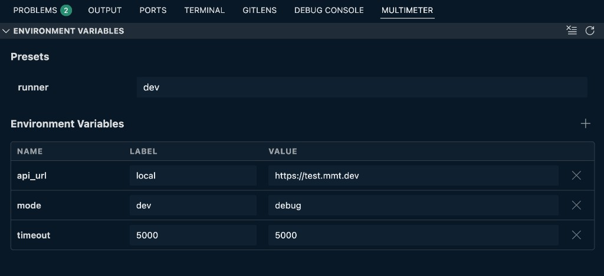

# Environment variables panel

Open the Multimeter sidebar and choose **Environment Variables** ({{btn:server-environment:Environment Variables}}), or run **Multimeter: Focus Environment Variables**. This panel holds workspace runtime variables and presets used by API runs, tests, and suites.

Toolbar actions (top right of the view):

| Control | What it does |
|---|---|
| {{btn:refresh:Reload}} | Re-read workspace environment variables and presets from storage |
| {{btn:clear-all:Clear}} | Opens a menu: clear **file** or **manual** variables, or **Clear all** (presets too). Clear **runtime** from the Runtime Variables header. Each action asks for confirmation. |

## Presets

When an environment file defines preset groups, they appear under **Presets**. Each row is a group name (for example `runner`) with a dropdown to pick a named option (for example `dev` or `prod`). Changing a preset applies that group's variable bindings (environment-layer only).

## Environment Variables table

| Column | What it shows |
|---|---|
| **Name** | Variable name — referenced as `e:name` or `<<e:name>>` in tests and APIs |
| **Label** | Selected choice from the env file definition (dropdown when the variable has choices) |
| **Value** | Environment value — edit inline when the variable allows it. Editing a file value marks the row as manual. File-backed `./….mmt` [live variables](./live-variables.md) show a clickable `(live)` chip that opens the target file |

Number, boolean, object, and list values keep their types in JSON requests and in this panel.

Click {{btn:add}} next to **Environment Variables** to add a new row. Enter a name and value, then confirm with **Add** (or cancel). Manual rows are stored in workspace storage only — they are not written to the `.mmt` file. Use {{btn:close}} on a row (inside the value field) to remove that variable from the workspace.

## Runtime Variables table

Suite and API `setenv` writes appear in a separate **Runtime Variables** table. The same name may exist in both tables: resolution uses the runtime value when present, otherwise the environment value.

To change variable definitions, preset groups, HTTP settings, or certificates in the `.mmt` file, see [Edit Environment](./edit.md).

---

See also: [Environment overview](./index.md) · [CLI](./cli.md) · [Project root](./project-root.md) · [Reference](./reference.md) · [Panels](../../panels/index.md)
