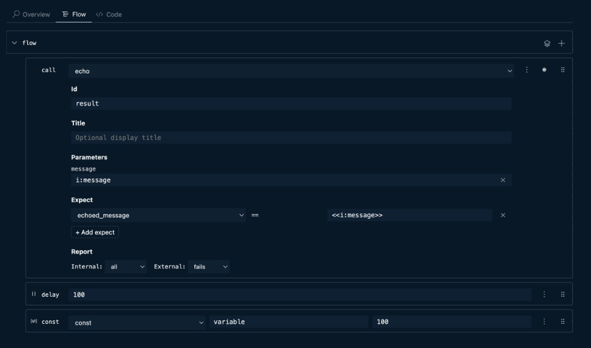

# Steps

Steps are the building blocks of a test. When placed at the test root, they run sequentially. Inside [stages](../stages/index.md), steps run within that stage; parallelism is controlled by the stages.

Use `call` when the request or flow already lives in a reusable imported file, and use `http` when you want to send a one-off HTTP request directly from the test. You can visualize and run the flow from the **Flow** view; each step here corresponds to a UI block in that view.

| Step type | What it does |
|---|---|
| [call](./call.md) | Invoke an imported API or test |
| [http](./http.md) | Send a one-off HTTP request |
| [run](./run.md) | Start an imported mock server |
| [check](./check.md) | Validate values; log failures and continue |
| [assert](./assert.md) | Validate values; stop the flow on failure |
| [judge](./judge.md) | AI judgment (`expect` / `require`) |
| [if](./if.md) | Conditionally run nested steps (`else` optional) |
| [for](./for.md) | Loop with a JavaScript-style header |
| [repeat](./repeat.md) | Repeat nested steps by count, duration, or forever |
| [delay](./delay.md) | Pause the flow for a duration |
| [js](./js.md) | Inline JavaScript |
| [print](./print.md) | Write a message to the log |
| [var, const, let](./variables.md) | Declare or update variables (`set`, `var`, `const`, `let`) |
| [setenv](./setenv.md) | Set environment variables at runtime for later steps and items |

Related (not step types): [Inline expect](../inline-expect.md) · [Operators](../operators.md) · [omit](../omit.md) · [Reports — Report levels](../reports.md#report-levels-all-fails-none)

For multi-stage flows with parallel execution, see [Stages](../stages/index.md).
